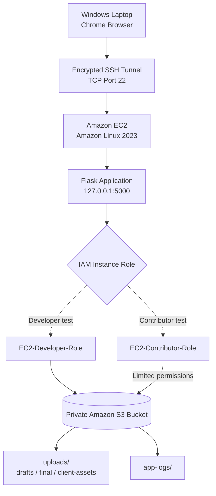

# CreativeFlow — AWS Security Architecture

## Architecture Diagram

**Important:** Developer and Contributor roles were assigned
to the EC2 instance separately during testing,
not simultaneously.

## Components

### Amazon EC2
- Amazon Linux 2023
- Python Flask web application
- Boto3 AWS SDK
- IAM instance profile for temporary credentials

### Amazon S3
- Private document storage
- Default SSE-S3 encryption
- Block Public Access enabled
- Separate uploads and application-log prefixes

### AWS IAM
- Developer role: broad project S3 access
- Contributor role: restricted uploads access
- S3 access controlled by IAM and bucket policies
- No static AWS credentials embedded in the application

### Network Security
- SSH port 22 restricted to an authorized IP
- SSH port forwarding to local Flask port 5000
- Flask debug mode disabled
- No direct public access to Flask port 5000

## Security Validation

Developer:
- Upload and download permitted
- Application log access permitted

Contributor:
- Upload and download under uploads/ permitted
- Application log access denied
- Bucket root listing denied

## Security Limitation

The exercise tested EC2 instance-role permissions.
It did not implement authentication for separate
individual website users.

## Resource Lifecycle

All project-specific AWS infrastructure was deleted
after testing to avoid unnecessary charges.
