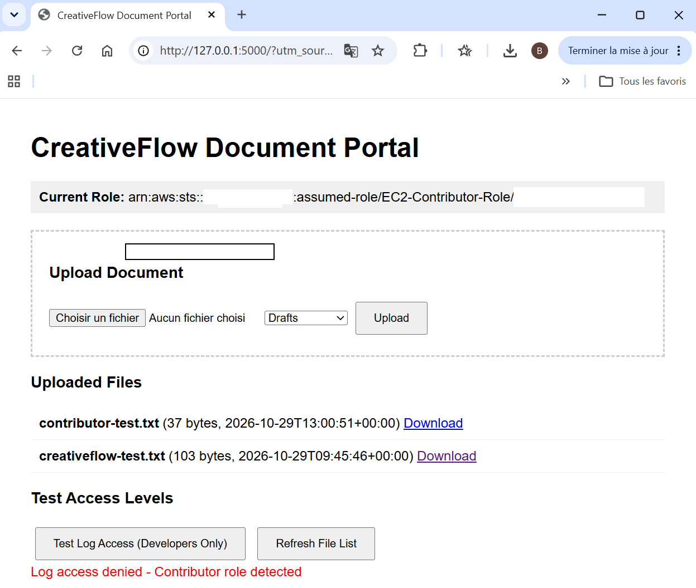
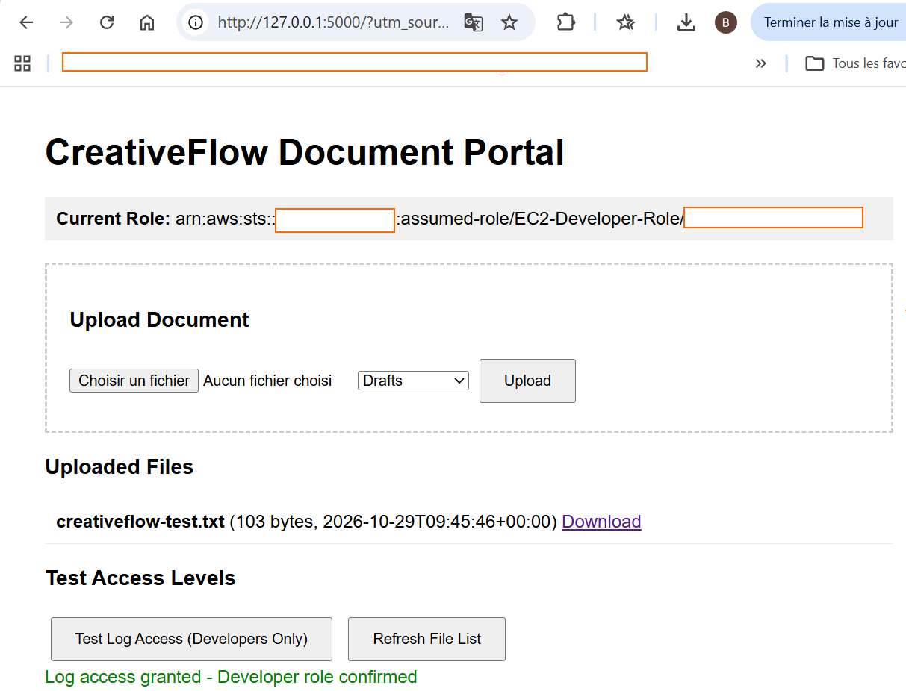
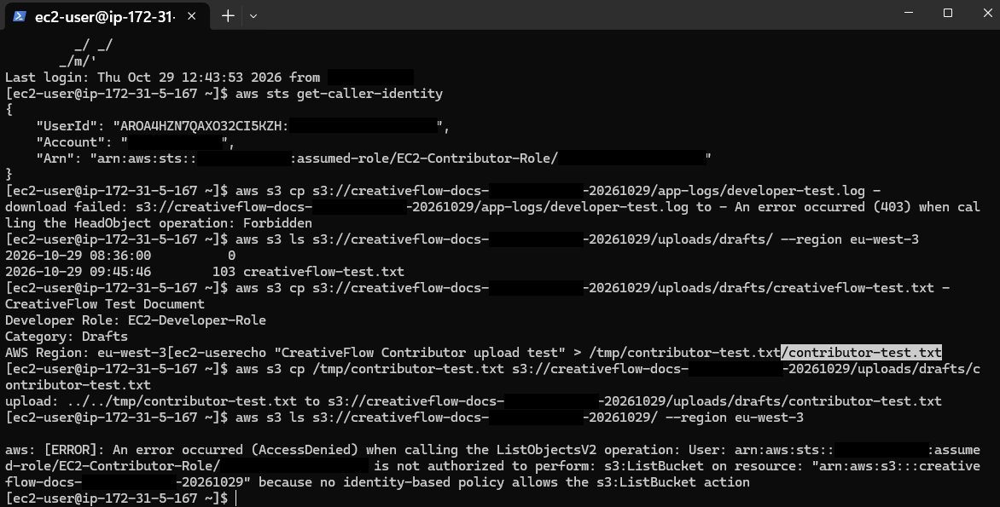
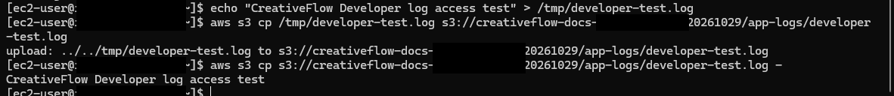
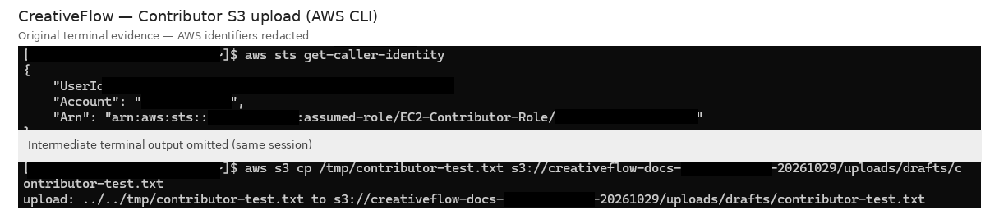

# CreativeFlow — Security Evidence

This folder contains screenshots from the AWS
CreativeFlow cybersecurity lab.

## Evidence

1. Developer access granted
2. Developer S3 log access
3. Contributor document upload
4. Contributor log access denied
5. AWS CLI AccessDenied security tests

Screenshots are sanitized to remove personal
information and AWS account identifiers.

The project infrastructure was deleted after testing.

## Contributor — Access Denied

The following screenshot shows the CreativeFlow application
detecting the Contributor role and denying access
to the developer-only log feature.

**Result:** PASS — Contributor log access denied.

The AWS CLI independently confirmed S3 access restrictions
with a 403 Forbidden response.

## Developer — Access Granted

The following screenshot demonstrates that the
CreativeFlow application recognized the Developer
IAM role and allowed access to the developer-only
log feature.

**Result:** PASS — Developer log access granted.

This was also independently verified using AWS CLI
by successfully uploading and reading a file
in the protected `app-logs/` S3 prefix.

## AWS CLI — IAM Access Control Verification

The following screenshot demonstrates that AWS IAM
and S3 enforced the Contributor role restrictions.

### Test 1 — Application Log Access

**Action:** Download a file from the protected
`app-logs/` S3 prefix.

**Expected:** Access denied.

**Actual:** `403 Forbidden (HeadObject)`

**Result:** PASS

### Test 2 — S3 Bucket Root Listing

**Action:** List the root of the CreativeFlow S3 bucket.

**Expected:** Access denied.

**Actual:** `AccessDenied (ListObjectsV2)`

**Result:** PASS

### Security Conclusion

The Contributor role was allowed to upload and
download documents under `uploads/`, but was
prevented from accessing protected application logs
or listing the S3 bucket root.

These tests provide independent evidence of
AWS IAM authorization enforcement.

## Developer — S3 Log Access

The Developer IAM role successfully uploaded and
downloaded a log file from the protected `app-logs/`
S3 prefix.

**Result:** PASS — Developer S3 log access allowed.

## Contributor — Document Upload

The AWS CLI confirms that the Contributor IAM role
successfully uploaded a test document to the
`uploads/drafts/` S3 prefix.

**Result:** PASS — Contributor S3 upload permitted.

